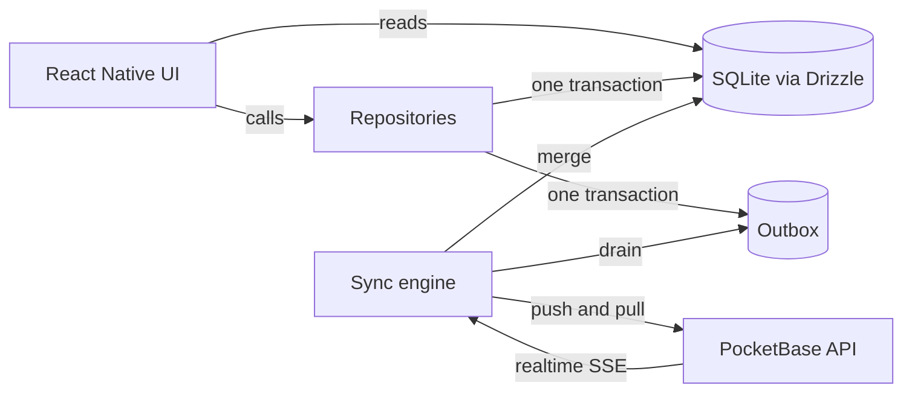

# Hearthlist

**A shared household grocery list that keeps working when the signal doesn't.**


<!-- Add after build: docs/media/demo.gif and 3 to 4 screenshots (lists, list detail, offline state, sync center) -->

## Why this exists

Households in cities with patchy mobile data still plan shopping together, usually in a WhatsApp group where items scroll away, nobody knows what has already been bought, and a message typed inside a market with no signal never arrives.

Hearthlist treats the phone as the source of truth. You can add, edit and tick off items with no connection at all. Changes queue on the device and merge safely when you are back online, even if two people edited the same item.

## Features

- Create or join a household with a 6-character invite code
- Multiple lists per household (for example Market, Supermarket, Pharmacy)
- Fast add with quantity parsing ("2kg rice", "tomatoes x3") and suggestions from your own history
- Tick items off with instant feedback; done items collapse out of the way
- Fully offline: changes queue and sync automatically
- Live updates from other members when online
- Always-visible sync status ("Up to date", "3 waiting", "Offline") and a sync center for problems
- Undo instead of confirm dialogs
- Light and dark themes, 48 dp touch targets, screen reader labels

## How it works

1. Every screen reads from a local SQLite database, so nothing waits on the network.
2. Every write updates SQLite and adds a row to an outbox in one transaction.
3. A sync engine drains the outbox to the server with retries and backoff, then pulls changes from other members.
4. The server decides conflicts with per-field-group last-write-wins and returns the merged result.

Full detail: [docs/architecture.md](docs/architecture.md).

## Tech stack

| Layer | Choice |
|---|---|
| App | React Native with Expo, TypeScript (strict), Expo Router |
| Local data | expo-sqlite with Drizzle ORM (live queries) |
| UI state | Zustand (UI-only state) |
| Lists and motion | FlashList, Reanimated, Gesture Handler, Expo Haptics |
| Secure storage | expo-secure-store (auth token) |
| Connectivity | @react-native-community/netinfo |
| Backend | PocketBase (single binary, SQLite, realtime), custom hooks |
| Errors | Sentry SDK pointed at self-hosted GlitchTip (optional) |
| Tests | Jest (unit and sync-engine integration) |

Everything is free and self-hostable. No paid services.

## Architecture



## Getting started

### Prerequisites

- Node.js LTS and npm
- Android emulator or a physical phone with Expo Go
- A PocketBase binary for your OS (pinned version is in `backend/PB_VERSION`)

### 1. Start the backend

```bash
cd backend
./pocketbase superuser create you@example.com 'choose-a-strong-password'
./pocketbase serve --http=0.0.0.0:8090
```

(On older PocketBase versions the command is `admin create`.) The `pb_migrations` and `pb_hooks` folders next to the binary are picked up automatically and create the collections, rules and custom routes.

### 2. Start the app

```bash
npm install
cp .env.example .env
npx expo start
```

Set `EXPO_PUBLIC_API_URL` in `.env` to match how your device reaches the backend:

| Device | URL |
|---|---|
| Android emulator | `http://10.0.2.2:8090` |
| Physical phone on the same Wi-Fi | `http://<your-computer-LAN-IP>:8090` |
| Physical phone over USB (after `adb reverse tcp:8090 tcp:8090`) | `http://localhost:8090` |

Expo Go is enough for development. A release build over plain HTTP needs cleartext traffic enabled (local demos only); for anything real, serve the backend over HTTPS.

### Scripts

| Command | Purpose |
|---|---|
| `npm start` | Start Expo |
| `npm test` | Run unit and sync-engine tests |
| `npm run typecheck` | TypeScript check |
| `npm run lint` | ESLint |
| `npm run db:generate` | Generate a Drizzle migration after schema changes |

## Project structure

```text
hearthlist/
  app/                 Expo Router routes (screens only)
  src/
    db/                Drizzle schema, migrations, repositories
    sync/              Outbox, engine, push, pull, realtime, backoff, merge
    api/               PocketBase client, auth, error mapping
    features/          Screens' components and hooks by feature
    ui/                Design tokens and shared components
    lib/               ids, clock, logger, helpers
    data/              Static catalog (categories, units)
  backend/
    pb_hooks/          Custom routes and conflict-guard hooks
    pb_migrations/     Collections and API rules as code
  docs/                design, story, demo, prd, cursorcontext, architecture
```

## Testing

`npm test` covers outbox coalescing, backoff, merge rules, the quick-add parser and an end-to-end sync run against a fake server with injected failures. The manual scenarios (airplane mode, two-device conflict, kill mid-sync, expired token) are in [docs/architecture.md](docs/architecture.md#14-testing-strategy).

## Known limitations

- One household per account
- The local database is not encrypted at rest (grocery data, low sensitivity)
- Conflict resolution trusts device clocks with a server-side clamp; a phone with a badly slow clock will lose ties
- No push notifications yet
- Single-node PocketBase; see the upgrade path in the architecture doc

## Roadmap

- Push notifications when someone adds to a shared list
- Barcode scan and price memory
- Multiple households
- Encryption at rest

## Documentation

| Doc | Contents |
|---|---|
| [prd.md](docs/prd.md) | Problem, scope, user stories, acceptance criteria |
| [design.md](docs/design.md) | UI/UX, tokens, screens, patterns replicated |
| [architecture.md](docs/architecture.md) | Data model, sync engine, backend, errors, caching, performance |
| [story.md](docs/story.md) | The narrative and interview talking points |
| [demo.md](docs/demo.md) | Demo script and recording guide |
| [cursorcontext.md](docs/cursorcontext.md) | Instructions for the AI coding agent |

## License

MIT