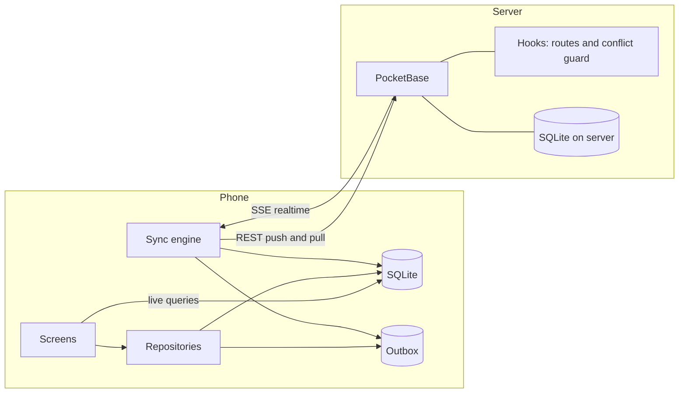
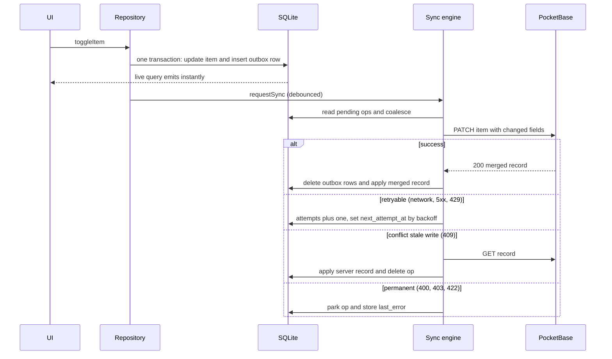

# Hearthlist: Architecture

## 1. Overview and principles

Hearthlist is local-first. The device database is the source of truth; the server is a sync target and a way to share data between household members.

| Principle | Where it lives |
|---|---|
| Offline-first, local DB as source of truth | `src/db`, all reads via live queries |
| Queue-and-retry writes | `src/sync/outbox.ts`, `push.ts`, `backoff.ts` |
| Optimistic UI | Repositories commit locally first; UI updates from live queries |
| Stale-while-revalidate (local cache first) | Reads never wait; pull refreshes in background |
| Graceful degradation | Sync chip, no modal offline states, local use continues without a session |
| Error handling and resilience | Error taxonomy (section 9), parked ops, per-route error boundaries |
| Idempotency | Client IDs, duplicate-create handling, safe retries |
| Secure storage and token refresh | `expo-secure-store`, PocketBase auth store, single refresh then park |
| Perceived performance | Local reads, deferred sync start, virtualized lists |
| Accessibility | Design doc rules enforced by the agent context |
| Observability | Logger interface with optional GlitchTip implementation |

## 2. System context



## 3. Client architecture

Layers, top to bottom: **routes** (`app/`), **features** (hooks and components), **repositories** (`src/db/repositories`), **database** (Drizzle on expo-sqlite), with the **sync engine** and **api** modules as the only network users. Dependencies point downward only; the sync engine calls repositories and merge functions, never the UI.

State separation:
- Persistent domain data: SQLite
- UI-only state (sheet open, theme, toasts): Zustand
- Network state: derived `SyncStatus` from NetInfo plus engine state plus outbox counts

## 4. Local data model

All timestamps are integer milliseconds since epoch.

```sql
CREATE TABLE households (
  id TEXT PRIMARY KEY,
  name TEXT NOT NULL,
  invite_code TEXT NOT NULL,
  created_at INTEGER NOT NULL
);

CREATE TABLE members (
  id TEXT PRIMARY KEY,
  household_id TEXT NOT NULL REFERENCES households(id),
  display_name TEXT NOT NULL
);

CREATE TABLE lists (
  id TEXT PRIMARY KEY,
  household_id TEXT NOT NULL REFERENCES households(id),
  name TEXT NOT NULL,
  sort_order REAL NOT NULL DEFAULT 0,
  archived INTEGER NOT NULL DEFAULT 0,
  created_by TEXT NOT NULL,
  created_at INTEGER NOT NULL,
  updated_at INTEGER NOT NULL,      -- LWW timestamp for the whole list record
  deleted_at INTEGER                -- tombstone
);

CREATE TABLE items (
  id TEXT PRIMARY KEY,
  list_id TEXT NOT NULL REFERENCES lists(id),
  household_id TEXT NOT NULL,
  -- content group
  name TEXT NOT NULL,
  quantity REAL,
  unit TEXT,
  note TEXT,
  category TEXT NOT NULL DEFAULT 'other',
  content_at INTEGER NOT NULL,
  -- state group
  checked INTEGER NOT NULL DEFAULT 0,
  checked_by TEXT,
  checked_at INTEGER,
  deleted_at INTEGER,
  state_at INTEGER NOT NULL,
  created_by TEXT NOT NULL,
  created_at INTEGER NOT NULL
);

CREATE INDEX idx_items_list ON items(list_id, deleted_at, checked);
CREATE INDEX idx_items_household_name ON items(household_id, name COLLATE NOCASE);

CREATE TABLE outbox (
  seq INTEGER PRIMARY KEY AUTOINCREMENT,
  entity TEXT NOT NULL CHECK (entity IN ('list','item')),
  entity_id TEXT NOT NULL,
  op TEXT NOT NULL CHECK (op IN ('create','update','delete')),
  payload TEXT NOT NULL,            -- JSON of changed fields (full record for create)
  attempts INTEGER NOT NULL DEFAULT 0,
  next_attempt_at INTEGER NOT NULL DEFAULT 0,
  status TEXT NOT NULL DEFAULT 'pending' CHECK (status IN ('pending','parked')),
  last_error TEXT,
  created_at INTEGER NOT NULL
);

CREATE TABLE sync_state (
  key TEXT PRIMARY KEY,             -- e.g. 'cursor:lists', 'cursor:items'
  value TEXT NOT NULL
);
```

Notes:
- Foreign keys on; WAL mode (default for expo-sqlite, verify).
- The local `deleted_at` is part of the **state** group for items.
- Server-side `updated` (PocketBase autodate) is only the pull cursor; it is unrelated to the client LWW timestamps.
- Migrations: generated by `drizzle-kit`, applied at startup by the Expo migrator.

## 5. Sync engine

### 5.1 Write path



### 5.2 Coalescing rules (applied per entity before draining)

| Sequence | Result |
|---|---|
| create then updates | One create with the final state |
| updates then updates | One update per field group with the latest values |
| create then delete (never synced) | Both dropped |
| updates then delete | One delete |
| delete then undo (before sync) | Both dropped; local state restored |

### 5.3 Drain algorithm

1. If offline or already draining, return.
2. Select pending ops whose `next_attempt_at <= now`, coalesce, order by `seq` with lists before items.
3. For each op: send; on success remove the op and apply the server response; on retryable failure schedule backoff and **stop the drain** (preserves ordering); on permanent failure park the op, park dependent child ops, continue.
4. After the drain, run a pull.
5. Update `SyncStatus`.

Backoff: delay = min(300 s, 2 s * 2^(attempts)) with plus or minus 20% jitter. Reset attempts on connectivity regained or foreground.

### 5.4 Idempotency

| Operation | Retry behavior |
|---|---|
| Create | Client ID is stable. A "record exists" response triggers a GET and counts as success. |
| Update | Re-sending the same partial update is safe because of per-group LWW. |
| Delete | Tombstone update is idempotent; a 404 counts as success. |

Crash window: if the server accepted a write but the app died before deleting the outbox row, the retry lands in the cases above and converges.

### 5.5 Pull algorithm

1. For each collection (`lists`, `items`, `members`), read its cursor.
2. Request records with `updated >= cursor`, sorted by `updated,id`, 200 per page (the `>=` plus idempotent apply avoids missing records that share a timestamp).
3. Apply each record with `merge` (5.6) in one transaction per page.
4. Store the new cursor after the page commits.
5. First sync after joining a household shows skeletons until the first page is applied.

### 5.6 Merge rules (client)

- If the entity has **any pending outbox op**: skip (the push response or the next pull converges it).
- Else: overwrite the local row with the server record. Server tombstones set `deleted_at` locally.
- Unknown parent (item whose list is not yet local): store the item; lists are pulled first so this is rare.
- Realtime events use the same merge function.

### 5.7 Realtime

Subscribe to `lists` and `items` after the first successful pull. Events go through `merge`. On disconnect and reconnect run a catch-up pull (SSE does not replay). In React Native the PocketBase SDK needs an EventSource polyfill (verify). If realtime is unavailable, the engine pulls on foreground and every 30 seconds while the app is open.

### 5.8 Sync status

| Status | Condition |
|---|---|
| Offline | NetInfo reports no connection |
| Syncing | Engine drain or pull in progress |
| Issue | Parked ops exist or auth needs renewal |
| Pending | Pending ops exist and not syncing |
| Up to date | None of the above |

## 6. Conflict resolution

| Case | Outcome |
|---|---|
| A edits name, B ticks item | Both survive (different groups) |
| A and B edit name | Later `content_at` wins |
| A and B tick the same item | Same result either way |
| A deletes, B edits content | Item deleted (state group), edit stored but hidden |
| A deletes, B unticks | Later `state_at` wins; if B is later, the item reappears |
| Both add "Rice" offline | Two items (a "possible duplicate" hint is a future feature) |
| List deleted while items edited | List tombstone hides its items |

Clock skew: timestamps come from the device. The server clamps any timestamp more than 5 minutes in the future to server time. A device with a slow clock can lose ties; documented limitation. Upgrade path: hybrid logical clocks.

Fallback if the group guard is too heavy on the day: one `updated_at` per item with item-level LWW, accepting that a concurrent tick and rename can lose one edit.

## 7. Backend (PocketBase)

Pin the PocketBase version in `backend/PB_VERSION` and read that version's docs before writing hooks (verify all field, rule and hook details).

### 7.1 Collections

| Collection | Fields |
|---|---|
| `users` (auth) | `display_name` (text 1 to 40), `household` (relation to households, optional) |
| `households` | `name` (text 1 to 60), `invite_code` (text, unique, 6 chars) |
| `lists` | `household` (relation), `name` (1 to 80), `sort_order` (number), `archived` (bool), `created_by` (relation), `client_updated_at` (number), `deleted_at` (number, optional) |
| `items` | `list` (relation), `household` (relation), `name` (1 to 120), `quantity` (number), `unit` (text up to 12), `note` (text up to 280), `category` (text), `checked` (bool), `checked_by` (relation), `checked_at` (number), `content_at` (number), `state_at` (number), `deleted_at` (number), `created_by` (relation) |

All collections include autodate `created` and `updated`; `updated` is the pull cursor.

### 7.2 API rules (starting point, check in the Admin UI rule tester)

| Collection | List and view | Create | Update | Delete |
|---|---|---|---|---|
| `households` | `@request.auth.id != "" && id = @request.auth.household` | superuser only (custom route) | superuser only | superuser only |
| `users` | self, or same household: `@request.auth.id != "" && household != "" && household = @request.auth.household` | open sign-up | self only; `household` not settable by clients | self |
| `lists`, `items` | `@request.auth.id != "" && household = @request.auth.household` | `@request.auth.id != "" && @request.body.household = @request.auth.household` | same household and `@request.body.household:isset = false` (also protect `list` and `created_by`) | **none** (soft delete only) |

### 7.3 Custom routes (in `pb_hooks`)

| Route | Behavior |
|---|---|
| `POST /api/hearthlist/households` | Auth required. Creates a household with a unique invite code, sets the caller's `household`, returns it. |
| `POST /api/hearthlist/join` | Auth required, rate-limited. Looks up the code, sets the caller's `household`, returns it. Invalid codes return a generic 404 message. |

Invite codes: 6 characters from `ABCDEFGHJKLMNPQRSTUVWXYZ23456789` (no I, O, 0, 1). Rate-limit join attempts (use PocketBase's built-in rate limiting if available in the pinned version, otherwise a counter in the hook).

### 7.4 Conflict-guard hooks

On update requests for `items`:
1. Clamp `content_at` and `state_at` to server now if more than 5 minutes in the future.
2. If the body contains content fields and `content_at` is older than the stored value, drop those fields.
3. If the body contains state fields and `state_at` is older than the stored value, drop those fields.
4. If every submitted group was stale, respond 409 with code `stale_write`; otherwise apply the rest and return the merged record.

`lists` use a single `client_updated_at` with the same clamp and stale logic.

### 7.4b Operations

- Local development: run the PocketBase binary with `--http=0.0.0.0:8090`
- Commit `pb_migrations` so collections and rules are reproducible
- Backups: use PocketBase's built-in backup feature for any hosted instance
- HTTPS required for anything beyond local demos

## 8. API contract used by the client

| Purpose | Call |
|---|---|
| Sign up | `POST /api/collections/users/records` |
| Sign in | `POST /api/collections/users/auth-with-password` |
| Refresh | `POST /api/collections/users/auth-refresh` |
| Create or join household | Custom routes in 7.3 |
| Push create | `POST /api/collections/{lists|items}/records` with client `id` |
| Push update | `PATCH /api/collections/{lists|items}/records/:id` |
| Pull | `GET /api/collections/{c}/records?filter=updated>=cursor&sort=updated,id&perPage=200` |
| Realtime | `subscribe('*')` on `lists` and `items` |

## 9. Error handling

| Class | Examples | Retry | User sees | Log |
|---|---|---|---|---|
| network | fetch failed, timeout, offline | Yes, backoff | Chip: Offline or Pending, no toast | breadcrumb |
| transient | 5xx, 429 (respect Retry-After) | Yes, backoff | Chip: Pending | warn |
| auth | 401 | Refresh once, then park and prompt | Banner: "Sign in again to resume syncing" | info |
| forbidden | 403 | No, park | Sync center entry | error |
| validation | 400, 422 | No, park | Sync center entry with plain reason | error (ids only) |
| conflict | 409 `stale_write` | Resolved by applying server record | Nothing | info |
| notFound | 404 on delete | Treated as success | Nothing | debug |
| local | SQLite failure | No | Full-screen recovery with Restart | error |
| unknown | JS exceptions | n/a | Route-level error boundary | error |

Rules: no raw error text in the UI; never log item content or emails; never clear local data because of an auth or network error.

## 10. Caching strategy

- SQLite is the cache. All reads are local; there is no TTL or invalidation logic for list data.
- Staleness is shown by "Last synced" in the sync center.
- Suggestions come from a local query over item names grouped by frequency, plus a static catalog.
- Catalog loads lazily on first quick-add focus.
- Cursors in `sync_state` make pulls incremental.

## 11. Performance plan

| Concern | Approach |
|---|---|
| Startup | Defer sync boot and catalog until after first interactive frame; no heavy work at module load; Hermes enabled |
| Rendering | FlashList, memoized rows, stable keys, scoped live queries per list |
| Writes | Single transaction per user action; coalesce on drain |
| Animations | Only the check toggle and sheets; reduce-motion respected |
| Bundle | No image assets, system fonts, no unnecessary libraries |
| Measurement | Release build on a low-end device; cold start with `adb shell am start -W`; scroll with the perf monitor on a 500-item list; APK size from the build output |

Budgets: cold start under 2 s, 60 fps at 500 items, interaction latency under 100 ms, APK under 40 MB.

## 12. Security and privacy

- Token in `expo-secure-store`; never logged
- API rules isolate households; verified by manual cross-account tests
- Invite codes rate-limited; generic failure messages
- HTTPS for non-local use; cleartext only for local demos
- No secrets in the repo; `EXPO_PUBLIC_*` variables are public by design and contain only the API URL and an optional error-reporting DSN
- Local database unencrypted by decision (low-sensitivity data); encryption at rest is a future item
- Collected data: email, display name, list content. No analytics SDKs.

## 13. Observability

- `logger` interface with console and optional Sentry (GlitchTip DSN) implementations
- Breadcrumbs for sync events (start, success, retry class, parked) with ids only
- Sync center doubles as in-app diagnostics
- PocketBase admin logs for server-side issues

## 14. Testing strategy

**Unit (Jest):** backoff, coalescing, merge, quick-add parser, invite-code validation, clock monotonicity, error mapping.

**Integration:** the sync engine against a fake server with injectable failures: network error, 500, 429, 401, 409, duplicate create, crash between server success and outbox delete. If Drizzle types allow, run against `better-sqlite3` with the same schema.

**Manual matrix:**

| # | Scenario | Expected |
|---|---|---|
| 1 | Airplane mode: add 20 items, tick 5, edit 3, reconnect | All appear on the second device; none lost or duplicated |
| 2 | Two devices offline: A renames, B ticks | Both changes present |
| 3 | Two devices offline: both rename | Later edit wins on both |
| 4 | A deletes, B edits | Item deleted on both |
| 5 | Kill app while syncing | Resumes; no loss or duplicates |
| 6 | Server stopped mid-sync | Chip shows Pending; backoff; recovers when server returns |
| 7 | Token expires while offline | Local use continues; banner on reconnect; queue resumes after sign-in |
| 8 | Invalid invite code | Clear message; repeated attempts get rate-limited |
| 9 | User A requests household B's items directly | Rejected |
| 10 | Sign out with pending changes | Warning with Sync first option |
| 11 | 500 items in one list | Smooth scroll at the target frame rate |
| 12 | Device clock set one hour ahead | Server clamp prevents future-dated wins beyond the window |

## 15. Architecture decision records

| ADR | Decision | Alternatives | Why |
|---|---|---|---|
| 1 | expo-sqlite with Drizzle | WatermelonDB, Realm | Typed queries, live queries, simple, current Expo path |
| 2 | PocketBase backend | Supabase, custom Go or Python | Free, single binary, realtime included; fastest for a mini app |
| 3 | Custom outbox sync | PowerSync, Firebase | Zero cost, fully explainable, small scope |
| 4 | LWW per field group (content and state) | Item-level LWW, CRDTs | Covers the most common conflict with modest complexity |
| 5 | Drizzle live queries instead of TanStack Query | TanStack Query | No server cache to manage; local DB is the cache |
| 6 | Soft deletes | Hard deletes | Deletions must reach offline devices |
| 7 | Client-generated IDs | Server IDs | Needed offline; enables idempotent retries |
| 8 | Stop-the-drain on retryable errors | Skip and continue | Preserves ordering and dependencies |

## 16. Scaling limits and upgrade path

PocketBase is a single node with SQLite: fine for hundreds of households. To scale, reimplement the same push, pull and cursor protocol as a Go or Python service on Postgres with row-level security. The client keeps its repositories, outbox and merge unchanged; only the API adapter and server-side conflict guard move.

## 17. Open questions

- Does the pinned PocketBase version allow client-supplied IDs on create as assumed?
- Which EventSource polyfill works cleanly with the pinned Expo SDK?
- Can the same Drizzle schema be exercised with `better-sqlite3` types, or should tests stay logic-only?
- Should invite codes expire?